# Tilt

An offline neon arcade for iOS, Android and the web: seven small, complete games on one lit wall — each with one idea and one technique drawn properly, and the feedback that makes a game feel like a machine rather than a form.

**Play it in a browser:** <https://tilt-arcade-77n.pages.dev> — the same code ships to iOS and Android through Expo.

**For your product:** the mobile MVP for your idea — one codebase for iPhone, Android and the web, native feel (sensors, haptics, sound, 60 fps animation), offline-first storage, and the polish that makes people keep it on their home screen.

<p>
  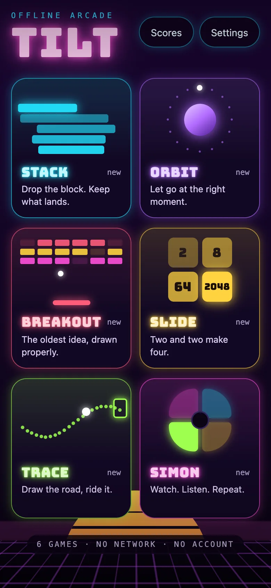
  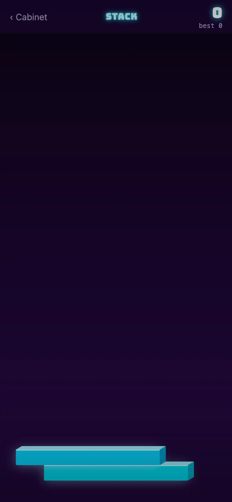
  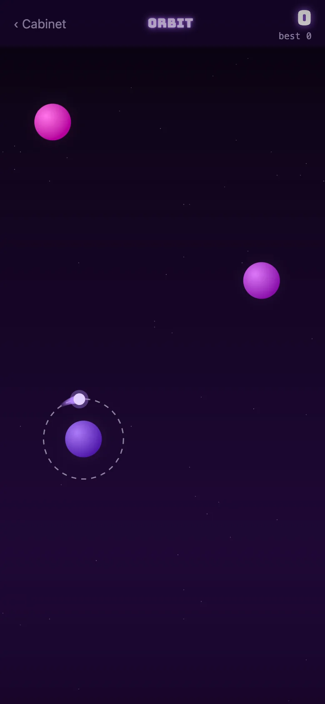
  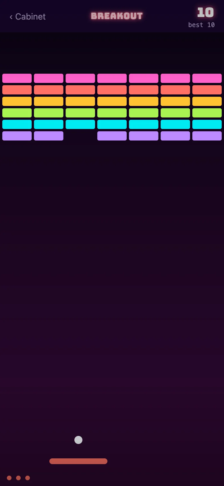
</p>
<p>
  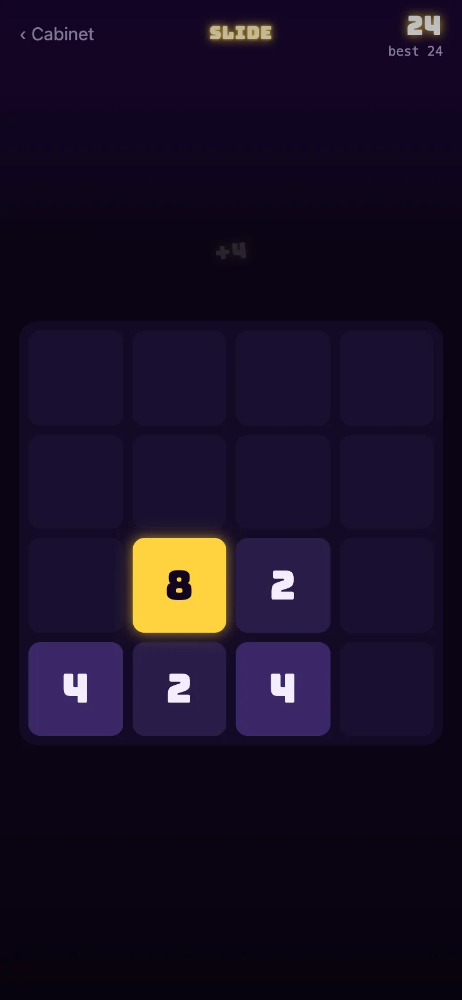
  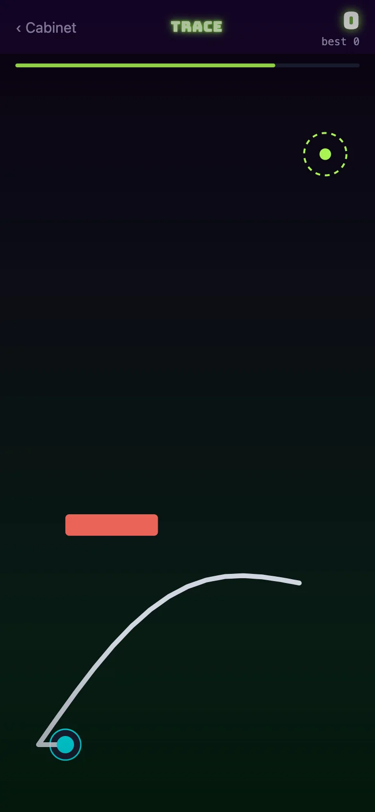
  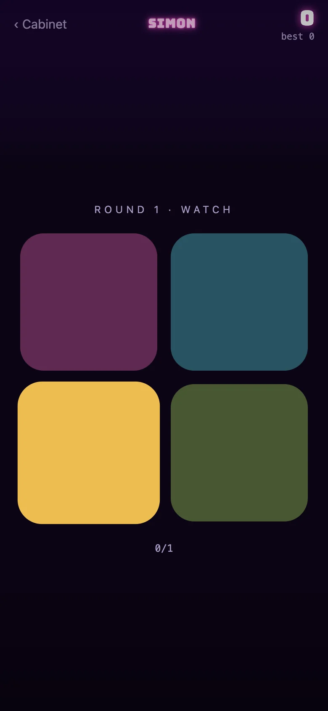
</p>

## In three seconds

- **Roll, played by tilting the phone:** the gravity sensor is read on the UI thread and levelled to however you hold it, the marble chases the light while holes open and pull; on a computer it rolls toward the pointer. The cabinet's cards lean with the phone too.
- **Seven arcade games in one app**, no network and no account: Roll, Stack, Orbit, Breakout, Slide, Trace and Simon, drawn on the GPU with Skia and moved on the UI thread with Reanimated — and a **daily tower**: the same Stack for everyone each day, one attempt, a streak on the wall.
- **Juice in every game:** sparks, words that pop ("PERFECT ×3"), screen shake and flashes, synthesised sound and haptics — and a reduced-motion setting that keeps the information and drops the movement.
- **Fast on the web too:** the cabinet scores Lighthouse mobile **91** (median of five runs; accessibility, best practices and SEO 100); a game's first paint went from **21.1 s to 4.6 s** once Skia's 3 MB of WebAssembly stopped blocking the app. Verified in the iOS simulator; 30 Jest tests, 22 Playwright checks, and an axe and Lighthouse gate on every push.

---

## Challenge → solution → result

| The problem | What was built | Measured |
| --- | --- | --- |
| Nothing to come back for tomorrow | The daily tower: the date seeds the rules (starting width, speed, entry side, colour), so everyone gets the same tower with no server; one attempt, recorded apart from the ordinary best, and a seven-day strip with the streak | Rules tested to be identical per day and in range across a year of dates; the one-attempt rule driven in the browser |
| Six games that looked like six forms | One visual world: tube lettering, a signature colour per machine, covers drawn in code, a sunset over a grid floor, cards that press and spring back | Own icon and splash; one look from the cabinet to every game-over card |
| Games that worked but did not feel like anything | A shared juice layer — bursts, floating words, shake, flash — that every game calls at its own moments, plus sound and haptics | Shake, flash and sparks stop under reduced motion; the words stay |
| On the web, the whole app waited for CanvasKit | The cabinet is in the exported HTML and paints at once; the WebAssembly loads in its own chunk on the first touch or two seconds after the cabinet paints, and a game imports its code only once it is ready | Game first paint **21.1 → 4.6 s**; cabinet paints in under 50 ms, Lighthouse mobile **91** |
| iOS drew neon glows as boxes and showed system fonts | Glow split by platform (stacked copies on iOS), fonts loaded before the first frame | Checked on an iPhone simulator, not only in a browser |

## The machines

| Game | The idea | The technique |
| --- | --- | --- |
| **Stack** | Tap when the sliding block lines up. Overhang is cut away; a perfect drop grows it back. | The slider moves on the UI thread in a frame callback and the canvas reads it directly; a tap reads the shared value at that instant and hands the arithmetic to a pure function. Blocks with lit faces, a camera that climbs, a hue that drifts with height. |
| **Orbit** | Hold to circle the planet, release to fly straight. Catch the next one. | Angle, flight and capture integrated in a worklet; React hears only "caught" or "lost". A particle trail, and a sky that is a runtime shader: stars from a hash, twinkling on a clock. |
| **Breakout** | Drag the paddle. Clear the wall. The ball gets quicker the longer it lives. | A pan gesture writing straight to a shared value, a ball integrated per frame, bricks marked dead in the worklet the instant the ball touches them so one can never score twice. Bursts and screen shake. |
| **Slide** | Swipe. Equal tiles merge. | 2048 with tiles that have identities, not just values, so a layout transition carries each one from where it was to where it went. A merge's two sources slide to the meeting point and vanish under the new tile. |
| **Trace** | Draw a road from the pad to the goal. Let go and the ball rides it. | A Skia path grown under the finger, sampled once into points, ridden by a ball driven by a single eased shared value. Walls to miss, an ink budget that tightens. |
| **Simon** | Four pads light up. Play it back. | Four synthesised tones, haptics on every pad, a sequence that grows and a comparison that is three lines long. |

Every game's arithmetic lives in a `logic.ts` beside it and runs the same on the UI thread, the JS thread and in Jest. Twenty-six tests prove the cuts, the merges, the bounces and the sequences before any of it is drawn; four more pin the daily tower's rules, calendar and streak.

## The cabinet

One dark room with lit screens in it, under a setting sun. Each machine has a signature colour and nothing else, so the wall reads as six distinct cabinets rather than one app with six screens. A card presses down under the thumb and springs back. The shell every game shares — the one line that explains it, the score in the corner, the game-over card that records the run and offers another — mounts each run fresh, so "play again" is a true reset no game has to implement.

Nothing leaves the device. Scores and settings live in SQLite's key-value store on a phone and `localStorage` in a browser. The nine sounds are 16-bit WAVs synthesised by [`scripts/make-tones.mjs`](scripts/make-tones.mjs) — sines and noise under short envelopes, no samples, no licences — and played through `expo-audio`, one player per sound, rewound on every press.

## On the web

Skia on the web is CanvasKit, three megabytes of WebAssembly that must be loaded before any module importing Skia is evaluated. The cabinet does not draw with Skia, so [`index.web.tsx`](index.web.tsx) starts the app at once; [`src/lib/skia-ready.web.ts`](src/lib/skia-ready.web.ts) — itself a separate chunk — is fetched on the first touch or two seconds after the cabinet has painted in its own type, and a game's chunk is imported only after it resolves. The fonts are awaited before the first frame only on iOS, where a face registered late is never applied; on the web the exported HTML carries the cabinet itself. The static export has one HTML page per route, a document with its own title, description and share image, and a fallback for deep links, so `/play/orbit` opens the game cold.

Two things only the browser suite found: under react-native-web a `Pressable`'s `onPressIn` never fired for a pointer click, so Simon could not be lost; and "Cabinet" from a game opened by deep link, with no history behind it, stayed put. Both fixed, both covered.

## Store listing

Screenshots at the App Store's 6.7-inch size (1290 × 2796, JPEG without alpha), taken from the build itself: [`docs/store`](docs/store).

<p>
  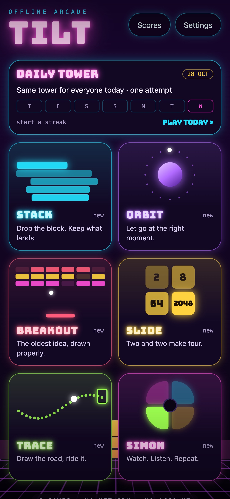
  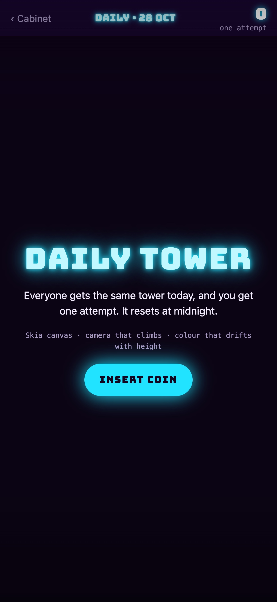
  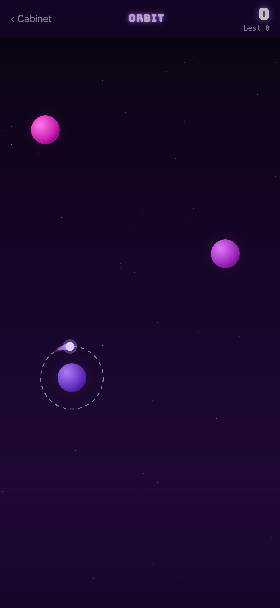
  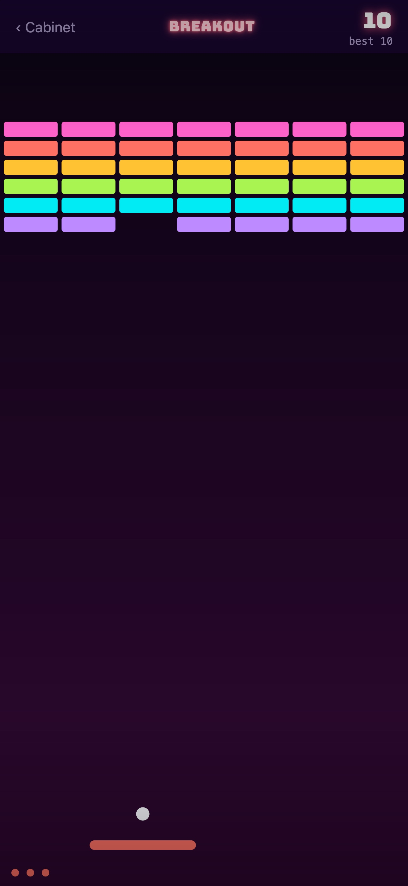
  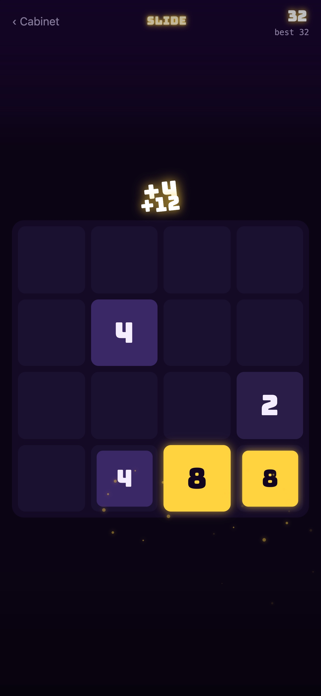
</p>

## Running it

Node 24 LTS.

```bash
npm install          # also stages CanvasKit for the web
npm run web          # Expo prints the local URL
npm run ios          # or android — Expo Go, or a development build

npm run check        # typecheck, lint, Jest, web export
npm run qa           # exports the web build, serves it, runs 22 Playwright checks (phone and desktop)
npm run deploy       # ships the web build to Cloudflare Pages
```

## Stack

Expo SDK 58 · React Native 0.88 · React 19.3 with the React Compiler · Expo Router · React Native Skia 2 · Reanimated 4 · Gesture Handler 3 · Uniwind on Tailwind CSS 4 · Zustand · expo-audio · expo-haptics · expo-sqlite · Jest with jest-expo · Playwright · Cloudflare Pages.

The React Compiler's immutability rule and Reanimated's shared values disagree by design — `sv.value = x` from a gesture callback is the API — so the rule is switched off for the six game files and on everywhere else.
