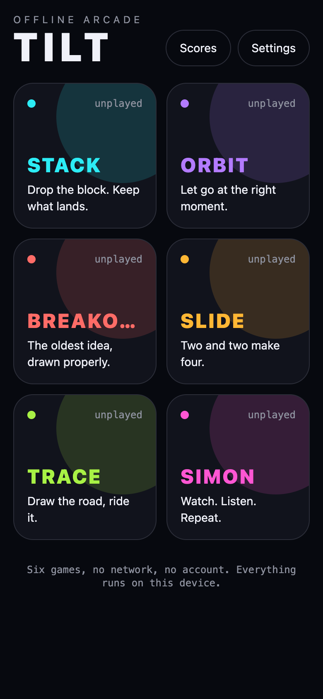
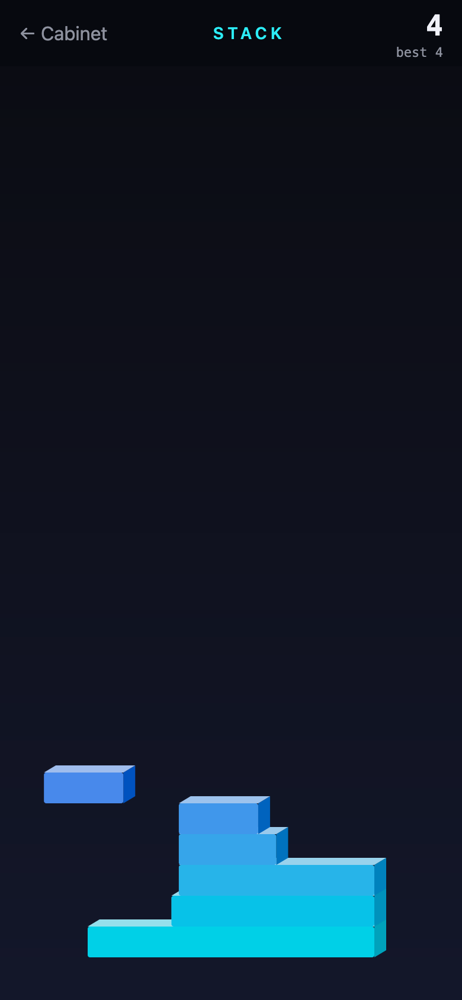
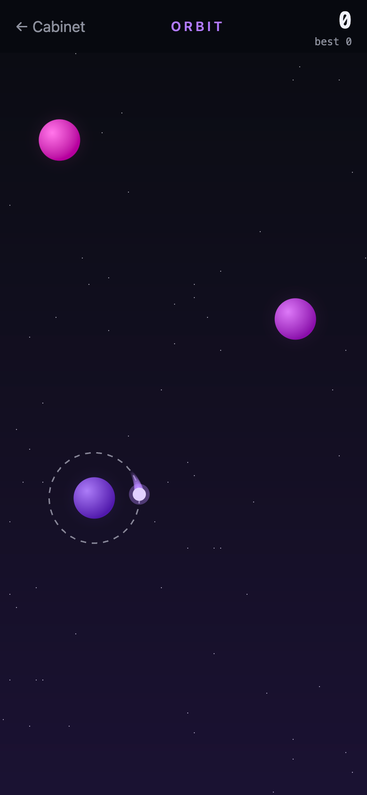
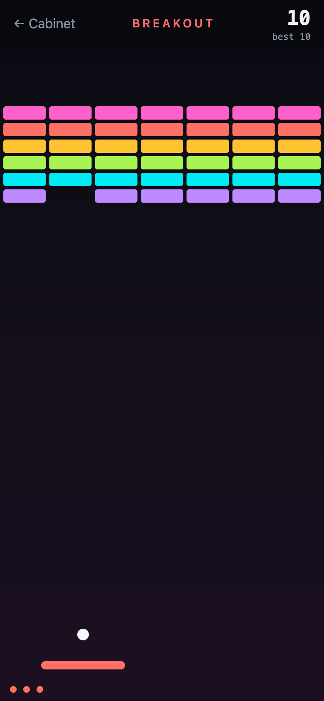
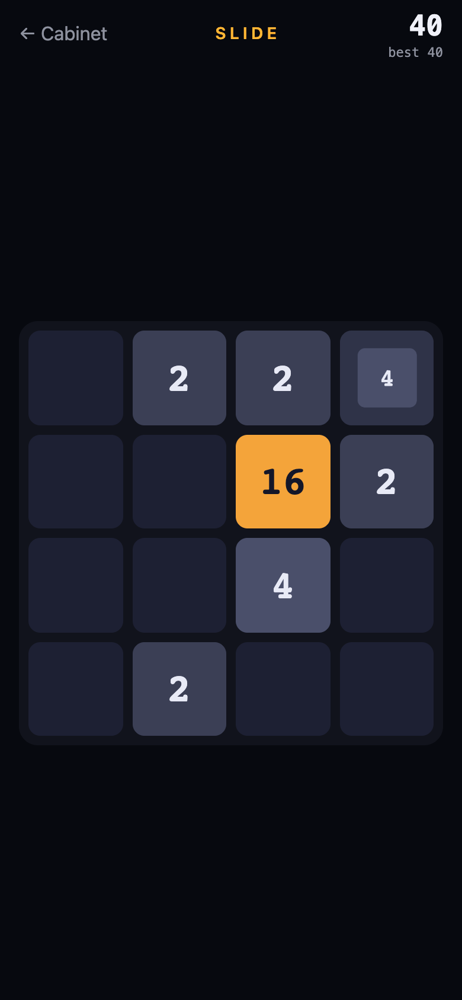
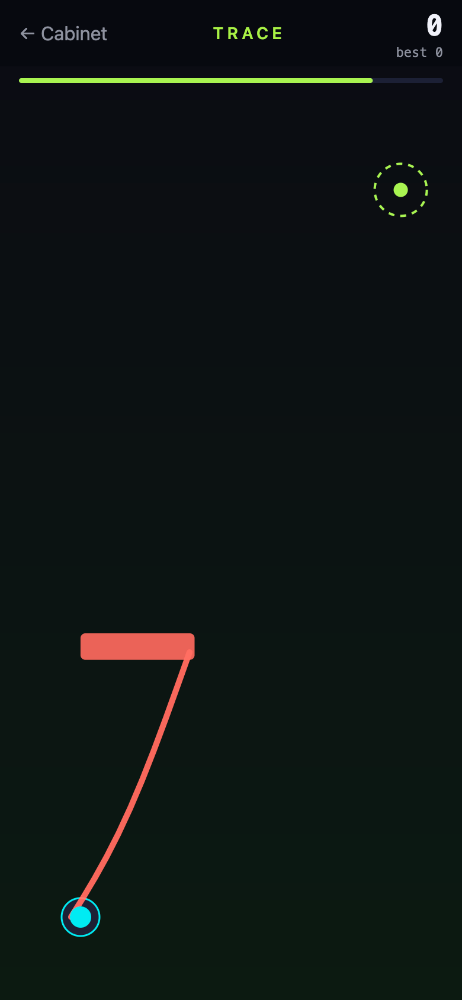
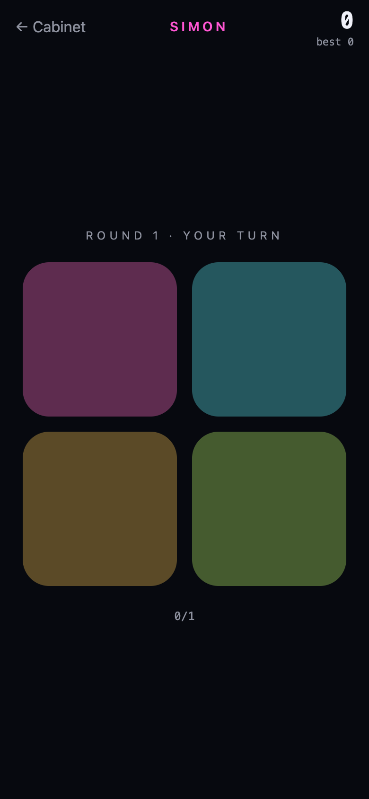

# Tilt

An arcade in your pocket: six games, no network, no account. Each one is a small, complete thing with one idea and one technique drawn properly — a GPU canvas, physics on the UI thread, a runtime shader, a path grown under the finger, tiles that keep their identity, tones synthesised at build time.

**Play it in a browser:** <https://tilt-arcade-77n.pages.dev> — the same code ships to iOS and Android through Expo.

<p>
  
  
  
  
</p>
<p>
  
  
  
</p>

---

## The machines

| Game | The idea | The technique |
| --- | --- | --- |
| **Stack** | Tap when the sliding block lines up. Overhang is cut away; a perfect drop grows it back. | The slider moves on the UI thread in a frame callback and the canvas reads it directly; a tap reads the shared value at that instant and hands the arithmetic to a pure function. Blocks with lit faces, a camera that climbs, a hue that drifts with height. |
| **Orbit** | Hold to circle the planet, release to fly straight. Catch the next one. | Angle, flight and capture integrated in a worklet; React hears only "caught" or "lost". A particle trail, and a sky that is a runtime shader: stars from a hash, twinkling on a clock. |
| **Breakout** | Drag the paddle. Clear the wall. The ball gets quicker the longer it lives. | A pan gesture writing straight to a shared value, a ball integrated per frame, bricks marked dead in the worklet the instant the ball touches them so one can never score twice. Bursts and screen shake. |
| **Slide** | Swipe. Equal tiles merge. | 2048 with tiles that have identities, not just values, so a layout transition carries each one from where it was to where it went. A merge's two sources slide to the meeting point and vanish under the new tile. |
| **Trace** | Draw a road from the pad to the goal. Let go and the ball rides it. | A Skia path grown under the finger, sampled once into points, ridden by a ball driven by a single eased shared value. Walls to miss, an ink budget that tightens. |
| **Simon** | Four pads light up. Play it back. | Four synthesised tones, haptics on every pad, a sequence that grows and a comparison that is three lines long. |

Every game's arithmetic lives in a `logic.ts` beside it and runs the same on the UI thread, the JS thread and in Jest. Twenty-six tests prove the cuts, the merges, the bounces and the sequences before any of it is drawn.

## The cabinet

One dark room with lit screens in it. Each machine has a signature colour and nothing else, so the wall reads as six distinct cabinets rather than one app with six screens. A card presses down under the thumb and springs back. The shell every game shares — the one line that explains it, the score in the corner, the game-over card that records the run and offers another — mounts each run fresh, so "play again" is a true reset no game has to implement.

Nothing leaves the device. Scores and settings live in SQLite's key-value store on a phone and `localStorage` in a browser. The nine sounds are 16-bit WAVs synthesised by [`scripts/make-tones.mjs`](scripts/make-tones.mjs) — sines and noise under short envelopes, no samples, no licences — and played through `expo-audio`, one player per sound, rewound on every press.

## On the web

Skia on the web is CanvasKit, a WebAssembly build that has to be loaded before any Skia module is evaluated. [`index.web.tsx`](index.web.tsx) loads it and only then mounts the router; `setup-skia-web` puts the file in `public/` on every install. The static export has one HTML page per route and a fallback for deep links, so `/play/orbit` opens the game cold.

Two things only the browser suite found: under react-native-web a `Pressable`'s `onPressIn` never fired for a pointer click, so Simon could not be lost; and "Cabinet" from a game opened by deep link, with no history behind it, stayed put. Both fixed, both covered.

## Running it

Node 24 LTS.

```bash
npm install          # also stages CanvasKit for the web
npm run web          # http://localhost:8081
npm run ios          # or android — Expo Go, or a development build

npm run check        # typecheck, lint, Jest, web export
npm run qa           # exports the web build, serves it, runs sixteen Playwright checks
npm run deploy       # ships the web build to Cloudflare Pages
```

## Stack

Expo SDK 58 · React Native 0.88 · React 19.3 with the React Compiler · Expo Router · React Native Skia 2 · Reanimated 4 · Gesture Handler 3 · Uniwind on Tailwind CSS 4 · Zustand · expo-audio · expo-haptics · expo-sqlite · Jest with jest-expo · Playwright · Cloudflare Pages.

The React Compiler's immutability rule and Reanimated's shared values disagree by design — `sv.value = x` from a gesture callback is the API — so the rule is switched off for the six game files and on everywhere else.
